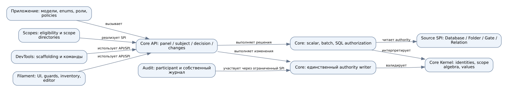
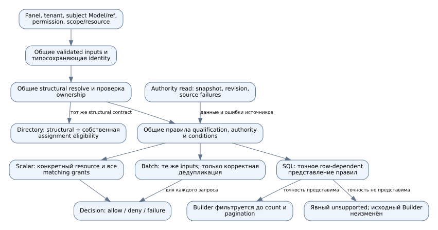
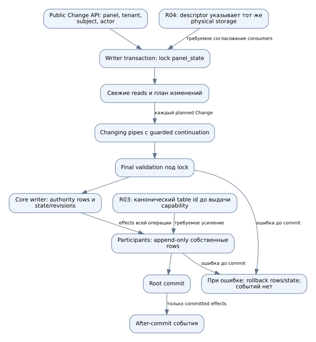
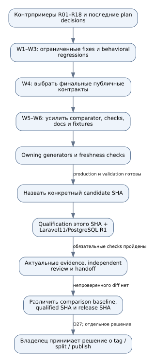

# Схемы аудита

SVG — самостоятельные файлы, открываются в браузере без Mermaid plugin или сервера. Mermaid — исходное представление для Markdown viewers. Все форматы получены из одного [graphs.json](graphs.json) через [render.py](render.py). Проверка реально рендерит Graphviz SVG, разбирает XML и сравнивает outputs; Mermaid синтаксис генерируется ограниченными шаблонами того же графа, отдельный Mermaid renderer не запускался.

## Существующие границы владения



[Открыть SVG](architecture-current.svg) · [Mermaid](architecture-current.mmd) · [DOT](architecture-current.dot)

Core остаётся владельцем identities, tenant/scope algebra и authority writes. Стрелки подписаны: это карта зависимостей/обязанностей, не порядок одного запроса. Scopes, Audit и DevTools физически находятся внутри core Composer package; независимыми runtime packages они этой схемой не объявляются. Filament — отдельный package. Исходники-владельцы перечислены в [REPORT](../REPORT.md) и соответствующих parts.

## Целевая согласованность решений



[Открыть SVG](decision-parity.svg) · [Mermaid](decision-parity.mmd) · [DOT](decision-parity.dot)

**Предложение W1, не описание готового refactor.** Общими становятся правила и validated inputs. SQL не получает заранее вычисленные matching grants всех будущих строк: он обязан представить их точную семантику либо отказаться. Directory использует общий structural verifier и собственные assignment rules; он не эквивалентен проверке конкретного resource permission. При изменении состояния между search и write final validation сохраняет право отказать.

## Путь изменения



[Открыть SVG](write-transaction.svg) · [Mermaid](write-transaction.mmd) · [DOT](write-transaction.dot)

Основная цепочка соответствует `Changes/Internal/ChangePipeline::run`: lock, fresh plan, pipes, final validation, core write, participants, root commit, events. `GrantWriter` меняет authority и соответствующие state/revisions. R03/R04 — подписанные места **требуемого усиления**. При retry план и проверки выполняются заново. No-op не создаёт effects/participant rows/events. Схема не обещает durable delivery внешнего сообщения и не изображает after-commit listener как часть DB transaction.

## Закрытие freeze



[Открыть SVG](freeze-workflow.svg) · [Mermaid](freeze-workflow.mmd) · [DOT](freeze-workflow.dot)

**Предложенная последовательность**, подробно в [IMPLEMENTATION](../IMPLEMENTATION.md). Генерация manifest и совместимость с baseline не заменяют behavioral tests. Изменение production/validation после квалификации требует проверки затронутого footprint. Последний узел — решение владельца согласно D27, не команда выполнить релиз в ходе аудита.

## Воспроизведение

Из корня репозитория; требуется установленный Graphviz `dot`, Python использует только stdlib:

```bash
python3 audits/2026-10-15-api-freeze/diagrams/render.py
python3 audits/2026-10-15-api-freeze/diagrams/render.py --check
```

Менять `graphs.json` и generator, затем регенерировать. `.mmd`, `.dot`, `.svg` вручную не редактировать. SVG не содержат external image/font references, scripts или сетевых запросов. При другой версии Graphviz возможен иной SVG layout: сначала прочитать diff, затем осознанно регенерировать.
